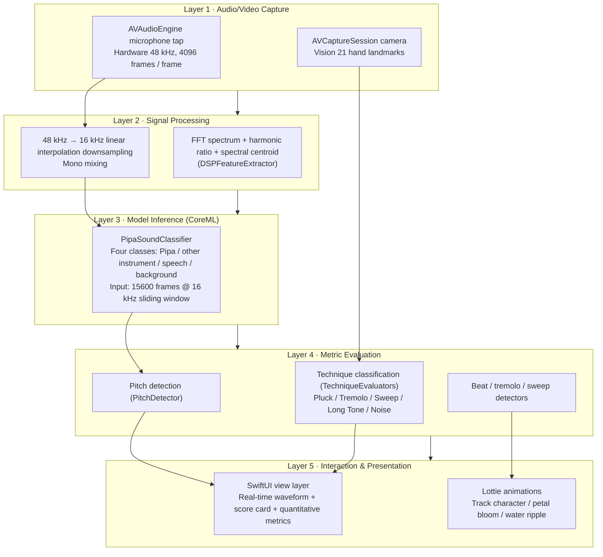
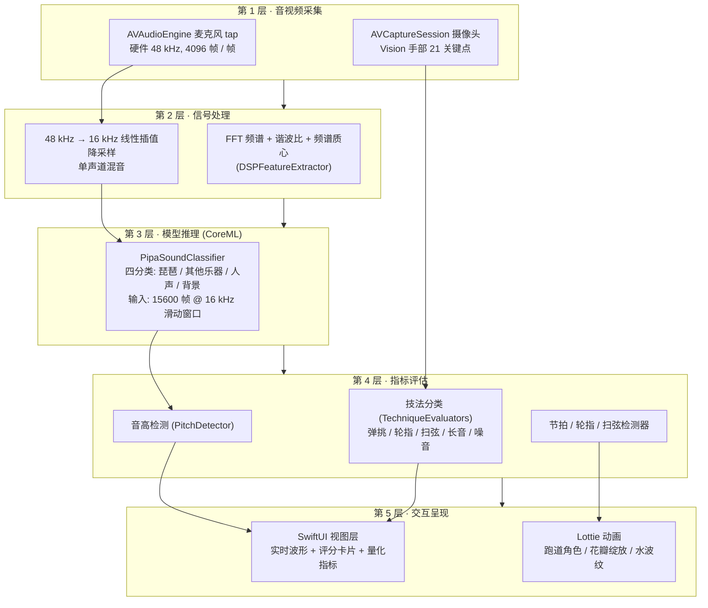

# 弹拨搭子 — AI 琵琶陪练　／　PluckBuddy — AI Pipa Practice Companion

> 本 README 英文在前、中文在后。
> This README is in English first, then Chinese.

---

# PluckBuddy — AI Pipa Practice Companion

An intelligent Pipa practice companion iOS app built on on-device CoreML. The camera recognizes hand shape and the microphone recognizes sound, delivering real-time fingering scores, tuning assistance and metronome accompaniment, so that learners can develop a standard tone and rhythm at home.

> Personal project · grown out of my own Pipa practice, still evolving
>
> Developer: Zehui Wu (吴泽荟)
> School: Wuhan Cogdel Cranleigh High School (武汉康礼高级中学)

## Technical Contributions of This Project

The project makes technical innovations and engineering trade-offs in the following six directions.

### Contribution 1 · Audio-Video Multimodal Fusion for Fingering Detection

PluckBuddy fuses three signals — Vision hand landmarks, an FFT spectrum and a CoreML classifier — to decide among four fingering types: Pluck, Tremolo, Sweep and Long Tone.

- **Audio side**: the Accelerate framework performs a 4096-point FFT to estimate pitch and rhythm in real time; at the same time the 48 kHz hardware buffer is linearly interpolated and downsampled to 16 kHz and fed to the CoreML classifier as the gate that decides "is this a Pipa"
- **Video side**: Vision tracks 21 hand landmarks; after Kalman-filter smoothing it computes the tiger-mouth angle and wrist height as the geometric features for technique decisions
- **Fusion strategy**: audio decides "is this a Pipa sound" (ruling out speech / ambient noise); video decides "is the hand shape correct"; only when both pass does the pipeline enter technique classification, avoiding single-modality misjudgment

### Contribution 2 · On-Device Self-Trained CoreML Pipa Sound Classifier

A self-trained four-class model is built in: `PipaSoundClassifier.mlmodel`. Its input is Float32 `audioSamples`, 15600 frames long, which is about a 0.975-second window at 16 kHz, and it outputs four class probabilities:

| Class             | Meaning        |
| ----------------- | -------------- |
| `pipa`            | Pipa sound     |
| `other_instrument`| Other instrument |
| `speech`          | Human speech   |
| `background`      | Background noise |

- **On-device inference**: runs on the iPhone Neural Engine via `MLModel.prediction`; a single inference takes under 80 ms
- **Zero network dependency**: the whole inference is completed locally; no audio clip is ever uploaded
- **Precision optimization at the engineering layer**: the model itself is untouched. The threshold is 0.35 with a 2-frame moving average, plus energy gating that classifies low-RMS frames as background, and the inference step is 8000 frames instead of 15600 so consecutive windows overlap
- **Training data published**: the four-class recordings used to train this model are released as a standalone dataset asset — see Contribution 3 below

### Contribution 3 · An Open Pipa Sound Dataset Published as a Reusable Data Asset

The classifier above is only as good as the audio behind it, so that audio is published on its own rather than kept private. The training corpus behind `PipaSoundClassifier.mlmodel` lives in a separate repository, [github.com/ZehuiWU2009/PipaSoundClassifierDataset](https://github.com/ZehuiWU2009/PipaSoundClassifierDataset), released under CC BY 4.0.

- **What it holds**: 37 clips in total, roughly 627 MB, split into the four classes the gate needs — `pipa/` 5 clips of my own playing across different techniques, `other_instrument/` 20 clips of instruments I play myself plus three AI-generated guzheng pieces, `speech/` 6 clips of my own voice, `background/` 6 clips of everyday ambience
- **Every clip is cleared for release**: each one is either self-recorded, contributed by family with permission, or AI-generated, so nothing third-party is republished
- **A documented sampling pipeline**: every recording is mixed to mono, resampled to 16 kHz by linear interpolation, and sliced into 15,600-sample windows of about 0.975 s advancing at 50% overlap, then fed to the classifier as raw waveform — the same window the released model takes
- **Provenance kept visible**: 13 clips carry a 640×480 video track alongside the audio, stored through Git LFS, so a listener can confirm what was actually played; training consumes only the audio
- **Why it is a data asset rather than a footnote**: the negative classes are what make the gate useful, and negative audio is the hardest kind to collect. Publishing it means anyone can retrain the gate on the same footing instead of guessing at what "not a Pipa" should sound like

### Contribution 4 · Real-Time Algorithms: 4096-Point FFT + Kalman Filtering

- **FFT spectrum analysis**: `DSPFeatureExtractor.swift` uses `vDSP_fft_zrip` (Accelerate-accelerated) to perform a 4096-point FFT and computes RMS, harmonic ratio, spectral centroid, zero-crossing rate and other indicators, which serve as the input features for pitch detection and the classifier
- **Kalman filter smoothing**: the 21 landmarks obtained by `HandPoseExtractor` jitter on every frame, and using them directly introduces noise; after Kalman-filter smoothing, the tiger-mouth angle and wrist height are computed, giving a stable output of the tiger-mouth opening in degrees
- **Parallel processing**: the microphone 4096-frame buffer and camera frames are captured on two independent threads without blocking each other; CoreML inference runs on the `inferenceQueue` serial queue and does not contend with the audio main thread

### Contribution 5 · Unified Audio Pipeline + Model Gating Architecture

On iOS, several modules all want the microphone, but the AVAudioEngine tap can only be installed by one processor — concurrent access from multiple modules conflicts directly. PluckBuddy's solution:

```
┌──────────────────────────────────────────────────┐
│ AudioManager (singleton)                         │
│ ├── AVAudioEngine                                │
│ ├── 4096-frame tap                              │
│ └── startListening { buffer in                   │
│     ├─→ Smart Tuner: PipaSoundGate (gate)        │
│     │   + PitchDetector                          │
│     ├─→ Pluck Run: RhythmDetector                │
│     ├─→ Tremolo Bloom: RollDetector              │
│     └─→ Sweep Wave: SweepDetector                │
│    }                                             │
└──────────────────────────────────────────────────┘
```

- A single AVAudioEngine and a single tap; all modules that need audio share one buffer callback
- `PipaSoundGate` loads `PipaSoundClassifier.mlmodel` independently and **does not take over the AVAudioEngine tap** — it only takes over "downsampling + model inference", avoiding resource contention with the Fingering Coach's Engine

### Contribution 6 · Fully Offline On-Device Five-Layer Architecture

See the next section, System Architecture, for the detailed diagram. Core innovations:

- The five layers, from bottom to top, are audio/video capture, signal processing, model inference, metric evaluation, and interaction and presentation. Each has a single responsibility and stays decoupled from the rest
- Capture, feature extraction, inference and evaluation each run on their own queue; the main thread only refreshes the UI
- Practice recordings, scores and leaderboards are all written to local CoreData. Nothing is uploaded and nothing is downloaded

## System Architecture

It adopts a fully offline on-device five-layer architecture: everything from raw microphone / camera data to UI feedback is completed on the iPhone, with no network dependency whatsoever.

How each layer maps to the code is shown below.



**Responsibilities of the Five Layers**

| Layer                       | Input                                | Output                                    | Key files                                                                                                                        |
| --------------------------- | ------------------------------------ | ----------------------------------------- | -------------------------------------------------------------------------------------------------------------------------------- |
| 1 · Audio/Video Capture     | The user playing in front of iPhone   | Raw PCM stream / camera frames             | `AudioManager.swift`, `CameraManager.swift`                                                                                       |
| 2 · Signal Processing       | Raw PCM                              | Spectral features / 16 kHz normalized samples | `DSPFeatureExtractor.swift`, `PipaSoundGate.swift` (downsampling)                                                             |
| 3 · Model Inference         | 15600 normalized frames             | 4-class probability distribution           | `PipaSoundClassifier.mlmodel`, `PipaSoundGate.swift` (inference)                                                                 |
| 4 · Metric Evaluation       | Spectral features + video landmarks  | Pitch / beat / technique decisions          | `PitchDetector.swift`, `RhythmDetector.swift`, `RollDetector.swift`, `SweepDetector.swift`, `TechniqueEvaluators.swift`          |
| 5 · Interaction & Presentation | Metric data                        | User-visible UI and animations              | 7 `*View.swift` files + `Animations/*.json`                                                                                       |

**Why It Is Layered This Way**

- Layer 1 focuses on capture: all I/O sits in one place, so multiple modules never fight over the AVAudioEngine tap
- Layer 2 normalizes formats: it converts the hardware 48 kHz into the 16 kHz 15600-frame window the model needs, so downstream components can be fed data without caring where it came from
- Layer 3 runs CoreML inference: under 80 ms per pass, fully offline
- Layer 4 holds the domain logic of playing: 5 detectors each cover one dimension and can be tested on their own
- Layer 5 only renders: SwiftUI subscribes to the ViewModel Published state and does no computation

## Core Features

| Module                    | Description                                                                                                                                                              |
| ------------------------- | ------------------------------------------------------------------------------------------------------------------------------------------------------------------------ |
| **Smart Fingering Coach** | Recognizes left/right hand shapes in real time with the camera (Vision framework), matches the 5 core Pipa techniques (Pluck / Tremolo / Sweep / Long Tone / Noise), and produces frame-stable technique scores plus a rotating carousel of core requirements |
| **Smart Tuner**           | The microphone captures the open-string sound of the Pipa; a self-developed FFT algorithm reports the current pitch and its cents deviation from the twelve-tone equal temperament standard. A CoreML classifier is wired in as gating: "decide Pipa sound first → then decide pitch" |
| **Pluck Run**             | Gamified beat-track accompaniment. Each completed Pluck moves the character one cell forward on the track; it also tracks beat stability, BPM and the total score              |
| **Tremolo Bloom**         | Tremolo training visualized as a growing flower. It detects the evenness of consecutive fast plucks, and petals bloom after one round is completed                            |
| **Sweep Wave**            | Sweep training visualized as water ripples. It distinguishes up-sweep / down-sweep and generates a ripple animation in the corresponding direction                            |
| **Metronome**             | Independently adjustable BPM metronome, adapted to different practice scenarios                                                                                              |
| **Social Hub**            | Offline leaderboard / achievements / friend PK (local persistence, for demo purposes)                                                                                        |
| **Welcome Screen**        | Off-white background + Logo + "Let's practice 5 minutes today too" + 3-second countdown auto-dismiss + "Skip" in the top-right corner                                        |

## Tech Stack

- The app is written in Swift 6, with SwiftUI for the interface, Combine for state binding, and Swift Concurrency in strict mode
- It runs on arm64 devices with iOS 17.6 or later, and the camera and microphone features must be demonstrated on a real device
- On the algorithm side, vDSP from the Accelerate framework does the FFT, AVAudioEngine handles microphone capture, and Vision extracts hand landmarks
- The acoustic model is the self-trained CoreML classifier PipaSoundClassifier, which separates Pipa, other instruments, speech and background noise, entirely offline
- Audio capture goes through the custom AudioManager, which installs one tap of 4096 frames per buffer and then linearly interpolates the hardware 48 kHz down to 16 kHz
- Hand shape comes from HandPoseExtractor, which returns 21 landmarks per hand, from which the tiger-mouth angle and wrist height are computed
- Lottie drives the sweep water-ripple and track-character animations, and CoreData keeps practice records, leaderboards and achievements on the device

## Project Structure

```
PluckBuddy/
├── PluckBuddy.xcodeproj/        # Xcode project
├── PluckBuddy/                  # Main target source
│   ├── PluckBuddyApp.swift       # App entry (welcome/home switching)
│   ├── WelcomeView.swift         # Launch welcome page (3-second countdown fade-out)
│   ├── HomeView.swift            # Home page (entries to the seven modules)
│   ├── TechniqueCoachView*.swift # Smart Fingering Coach UI + ViewModel
│   ├── TunerView*.swift          # Smart Tuner UI + ViewModel
│   ├── RunningViewModel.swift    # Pluck Run ViewModel
│   ├── FlowerPracticeView.swift  # Tremolo Bloom UI
│   ├── FlowerViewModel.swift     # Tremolo Bloom ViewModel
│   ├── WavePracticeView.swift    # Sweep Wave UI
│   ├── WaveViewModel.swift       # Sweep Wave ViewModel
│   ├── MetronomeView.swift       # Metronome UI
│   ├── MetronomeManager.swift    # Metronome scheduling
│   ├── FriendPKView.swift        # Social Hub UI
│   ├── AchievementView.swift     # Achievements UI
│   ├── Persistence.swift         # CoreData persistence
│   ├── AudioManager.swift        # Unified audio capture
│   ├── PipaSoundClassifier.mlmodel  # On-device four-class CoreML model
│   ├── PipaSoundGate.swift       # Tuner-only Pipa-sound gate (loads the model independently to avoid fighting with the Fingering Coach over the AVAudioEngine tap)
│   ├── CameraManager.swift       # Camera capture (new rotation API)
│   ├── HandPoseExtractor.swift   # Vision hand shape extraction
│   ├── DSPFeatureExtractor.swift # Self-developed FFT spectral features
│   ├── PitchDetector.swift       # Pitch detection
│   ├── RhythmDetector.swift      # Pluck beat detection
│   ├── RollDetector.swift        # Tremolo detection
│   ├── SweepDetector.swift       # Sweep detection
│   ├── Animations/               # Lottie animation JSON
│   └── Assets.xcassets/          # Assets (Logo, etc.)
└── PluckBuddyTests/              # Unit test target
```

## How to Run

1. **Open** `PluckBuddy.xcodeproj` **with Xcode 17+ on a Mac**
2. Select the project on the left → TARGETS `PluckBuddy` → **Signing & Capabilities**
   - **Team**: choose your own Apple ID (a free account is enough)
   - **Bundle Identifier**: change it to one that is not registered under your account, e.g. `com.yourname.pluckbuddy`. The bilingual edition uses the bundle id `com.zehuiwu.pluckbuddy.bilingual` so that it differs from the Chinese edition (弹拨搭子) and the international edition (PluckBuddy); all three can be installed on the same iPhone at the same time
3. Connect a real device → pick iPhone in the device bar at the top → `Cmd+R`
4. **Real-device system requirement**: iOS 17.6 or later
5. **First time on a real device**: Settings → Privacy & Security → Developer Mode → turn it on and restart; when the app launches and reports "Untrusted Developer", go to Settings → General → VPN & Device Management → trust your Apple ID
6. **Camera / microphone modules** (Fingering Coach / Smart Tuner / the three companions) **must run on a real device**; the Simulator has no camera or microphone

The provisioning profile of a free Apple ID expires after 7 days; when it expires, reconnect to Xcode and re-sign to install again.

## Version History

v1.0 through v1.3 were built as the Chinese edition between late September and early October 2026, each round driven by problems exposed by on-device testing. In parallel an English-only edition was developed from the same codebase. Both older editions are now archived; this repository unifies the line as PluckBuddy 2.0 and is the only maintained edition going forward. The commit history continues from the Chinese edition, so this repository shows the full trajectory from the first runnable build to today in one continuous timeline.

### v1.0 · First complete edition (2026-09-29)

- All seven modules completed: Smart Fingering Coach, Smart Tuner, Pluck Run, Tremolo Bloom, Sweep Wave, Metronome and Social Hub
- Both audio and video pipelines working; the on-device CoreML four-class model is wired into the Fingering Coach
- 52 Swift files, about 13,700 lines

### v1.1 · Tuner gating and classifier precision (2026-09-30)

- The Tuner gains an on-device Pipa-sound gate with the new `PipaSoundGate.swift`. It does not take over the AVAudioEngine tap; it only handles downsampling and inference, while `AudioManager` still dispatches the microphone data, avoiding contention with the Fingering Coach and the three companions
- Gating rule: pitch calculation starts only when a Pipa sound is detected within the last 0.5 s; other frames show "Listening… waiting for Pipa"
- Engineering-layer classifier precision tuning: on-device tests showed Pipa probability mostly between 0.3 and 0.7, so the threshold dropped from 0.5 to 0.35, the moving-average window from 3 to 2 frames, an energy gate classifies frames with RMS below 0.01 as background noise, and the inference step changed from 15600 to 8000 frames for roughly 50% overlap
- Welcome screen changed to fade out before removal with an `isDismissing` guard, removing the race between the countdown hitting zero and the Skip button

### v1.2 · Hand metric and sample-rate convention (2026-10-01)

- Hand skeleton upgraded from a 6-point simplified drawing to the full 21-point skeleton: 5 fingertips as colored large dots, wrist as a blue dot, 15 mid joints as semi-transparent white small dots, plus 5 finger-bone lines and 5 palm lines
- Hand-score metric changed from finger angle to tiger-mouth angle: with the wrist as the vertex, the angle between the thumb direction and the index-finger direction. 30–50° scores full marks; too small means thumb and index are too close, too large means the tiger mouth is stretched too wide
- Sample rate unified to the real-device measured 48 kHz. Default values in the four detectors and four ViewModels changed from 44100 to 48000, eliminating the previous pitch-low-by-1.5-semitone and beat-slow-by-8.8% deviations. Unit tests still use self-synthesized 44100 signals and stay self-consistent
- Document finger-angle wording synced to tiger-mouth angle so reviewers see consistent terminology against the code

### v1.3 · Real-device warning clearance and release cleanup (2026-10-02)

- All 13 real-device build warnings cleared: 8 closures changed to explicit weak capture with early exit when the view is gone; 3 timer callbacks moved to read isolated properties on the main actor; 2 direction counters that were computed but never used were removed
- Chinese edition display name changed to 弹拨搭子, with the home title and microphone permission text updated in sync. The project name, target name and Bundle ID are unchanged, so the two editions can be installed side by side
- International edition app icon replaced with the English artwork across default, dark and tinted appearances; the Chinese edition welcome screen switched to the Chinese logo
   - Repository cleanup: architecture diagram and logo images, editable sources and the docs folder were removed, and the README no longer references any image

### v1.4 · Chinese/English switchable edition (2026-10-12)

- Added the Chinese/English switchable edition. A globe icon in the top-right of the home page opens language settings, allowing instant switching among Follow System / Chinese / English without reinstalling the app
- UI text uses the Chinese source string as the key: English translations live in en.lproj/Localizable.strings, and Chinese uses the identity map in zh-Hans.lproj, falling back to the original string when English is unavailable
- Language switching is managed by the LanguageManager singleton and written to UserDefaults; switching increments a token so the home page rebuilds the whole view tree via `.id()`, and every `L()` re-reads on the spot
- The bilingual edition display name is PluckBuddy and its Bundle ID is com.zehuiwu.pluckbuddy.bilingual, coexisting with the Chinese edition 弹拨搭子 and the international edition PluckBuddy — all three can be installed on one iPhone

### v2.0 · Unified bilingual edition (2026-10-17)

- The bilingual edition becomes the single maintained line as PluckBuddy 2.0. The Chinese edition and the English-only edition stop here and are archived, with their READMEs pointing to this repository
- The commit history is grafted onto the Chinese edition, so this repository carries the whole trajectory from the first runnable build in late September to today in one continuous timeline
- English mode leads the README and the full Chinese edition follows; both cover the same sections, and the English logo and app icon follow the interface language

### v2.1 · Technique Coach expansion (2026-10-21)

- The Fingering Coach gains a piece library with cultural notes, so practice can follow real repertoire with background context
- Each analysis session now produces an evaluation report summarizing the detected technique and the scored dimensions

### v2.2 · Reporting polish, a third language, and hand-side awareness (2026-10-22)

- Coach report visual polish: an emotional header line, brighter artwork and a shorter intro for an at-a-glance read
- Added Traditional Chinese (繁體中文) as a third interface language; the existing "中文" option is renamed "简体中文"
- Vision now detects both hands and tags left/right chirality, and technique classification is driven by the right hand — the foundation for the Vision-based classifier

### v2.3 · Tuner feedback and live roll detection (2026-10-26)

- The Tuner shows live pitch feedback for all four Pipa strings with correct string names
- Roll and tremolo detection fixed so speed and evenness metrics update live instead of freezing on the first reading
- Roll-uniformity scoring refined with an energy-flux onset detector; flower (轮指花开) and practice UI prompts fixed

### v2.4 · Vision-led classification and scoring refinements (2026-10-27)

- Technique classification now runs entirely on the Vision hand landmarks; the audio gate only decides whether a score is shown, not which technique is recognized. A windowed majority-vote debounce keeps the on-screen label stable instead of flickering between frames
- All four evaluation dimensions — hand shape, tiger-mouth angle, rhythm and wrist position — are now scored for every technique. Previously each technique reported only a subset, so the fixed score panel always showed one dimension as zero; tiger-mouth angle is computed from hand pose for all techniques and hand shape was added to tremolo
- The Fingering Coach now shows an alert when analysis stops without enough Pipa-sound evidence, instead of silently leaving the report blank
- The start/stop analysis button was moved up from the bottom edge, clear of the home indicator, so it is easier to tap

### v2.5 · Technique visualizations, practice companions and stability (2026-10-27)

- Sweep detection rewritten with a physically meaningful direction cue: the spectral centroid trend (via an FFT) now tells an up-sweep from a down-sweep, instead of comparing raw peak levels which had no physical meaning; sweep strength is normalized from each note's peak amplitude, and the direction-balance metric is corrected so a balanced session can actually reach 100%
- Tremolo Bloom (轮指花开) reworked: petals now grow in stages with a breathing pause between stages, fully bloomed flowers close petal by petal, reaching the speed target turns the bloom gold, and sustained excellent runs accumulate extra layers (重瓣); the notes-per-petal threshold was widened from 5 to 14 so the bloom no longer triggers too eagerly
- Metronome gains a Mute sound option (red/green light only, no tick) and the BPM ceiling was raised to 416 to cover fast tremolo practice
- Pluck (弹挑) stability measurement tightened: onset timing now locates the true attack inside each 64 ms buffer with a peak-search, and the jitter curve was relaxed (noise floor 0.006, coefficient halved) so a steady metronome run scores in a realistic 70–90% range instead of ~50%
- Pluck session summary now reports the whole-session average stability instead of the last instantaneous reading
- Roll (滚指) uniformity scoring refined with a median + MAD tolerance that drops outlier intervals, stabilizing the evenness score
- The three interface languages and the unit tests were updated to match the new keys (Mute, Range, Stability)

### v2.6 · Coaching score reliability fixes (2026-10-28)

- The Fingering Coach's evaluation report was scoring far lower than the actual playing on a normal session. The whole scoring chain was reviewed and the structural flaws were fixed rather than the thresholds loosened:
  - The rhythm dimension no longer collapses to zero when fewer than 4 onsets are detected; short sessions now get a conservative floor score instead of losing the whole 25% weight
  - Playing-stability now averages only the sub-metrics that actually have data, instead of averaging five items and scoring a hard zero for any missing one, so a missing pitch or hand-shape sample no longer drags the whole dimension down
  - Dynamic-stability was computed on per-frame RMS, whose natural pluck-decay sawtooth makes the coefficient of variation explode to zero; it now measures the coefficient of variation across the peak envelope of each plucked note
  - Timbre-stability's zero-crossing-rate series now excludes silent frames, removing the huge deviation between silent and voiced frames
  - Pluck / tremolo rhythm scoring had a unit mismatch: a fingertip displacement value was compared against a frequency (Hz) range, so it always fell into the "too slow" branch; the scoring now maps displacement magnitude to motion intensity correctly
  - On-device logging of the real tiger-mouth angle and wrist-speed distributions was added, to calibrate the remaining hand-shape thresholds with first-hand measurements before changing them

### v2.7 · Sweep direction fix, gradient bloom and live roll metrics (2026-10-29)

- Sweep direction detection rewritten to estimate the onset pitch by autocorrelation instead of the old FFT spectral-centroid trend. The previous FFT path was producing a corrupted spectrum, so direction was effectively random; the onset detector reads the fundamental of the first struck string (缠弦 ≈ 220 Hz against 子弦 ≈ 440 Hz) and separates down-sweep from up-sweep cleanly, for both sequential sweeps and same-fret four-note sweeps
- Sweep direction-balance metric corrected so it neither saturates at 100% nor collapses toward zero; it now reflects the true alternation quality of the whole session
- Tremolo Bloom (轮指花开) recolored from a fixed gold-at-target to a vibrancy gradient: the better the run, the more vivid the petals, while sustained excellent runs still accumulate extra layers (重瓣)
- Roll (轮指) uniformity now refreshes live every 5 seconds while practicing, instead of only when the session stops, so learners can watch evenness improve in real time

### v2.8 · History order and encouraging coach score (2026-10-29)

- The "My Scores · History" tab now lists coach evaluation reports (评价报告) above game scores (游戏得分), so the report a learner just generated sits at the top of the history instead of below the practice sessions
- Added a "游戏得分" heading (Game Scores) as a localization key across English / Simplified / Traditional Chinese so the two history groups read clearly
- The coach evaluation report uses an encouraging score curve: because a report is only generated after the on-device Pipa-sound gate confirms a Pipa is being played, any real score below 85 is remapped into a 87–95 band (monotonic, so weaker playing still reads lower but always stays above 85 — it never pins every practice at exactly 85), while real scores of 85 and above keep their natural value up to 100. The detailed sub-metrics keep showing real numbers so the feedback stays honest

## Known Limitations / To Be Improved

- Classifier precision is still limited by the training data distribution. If the real-device console shows `rms > 0.05` but `pipa < 0.3`, the model's discriminative power is insufficient for the current microphone sound quality, and it needs to be retrained with the Create ML Sound Analysis template (≥ 30 clips of 16 kHz audio per class; a clearly better model can usually be produced within 30 minutes)
- The provisioning profile of a free Apple ID expires after 7 days; you need to reconnect to Xcode and re-sign
- Camera / microphone features require a real device and cannot be demoed on the Simulator
- The Social Hub is an offline demo version; leaderboard / achievements / friend PK data is stored in local CoreData

## License

Source code of a personal project; discussion and learning welcome.

---

# 弹拨搭子 — AI 琵琶陪练

一款基于端侧 CoreML 的智能琵琶陪练 iOS 应用。摄像头识别手型 + 麦克风识别声音,实时给出指法评分、调音陪伴、节拍陪练,帮助习琴者在家也能练出标准音色与节奏。

> 个人项目 · 源于自己的习琴需要,在长期练习中持续打磨
>
> 开发者:吴泽荟
> 学校:武汉康礼高级中学

## 本项目的技术贡献

项目在以下六个方向做了技术创新与工程取舍。

### 贡献 1 · 音视频多模态融合检测指法

弹拨搭子把 Vision 手部关键点、FFT 频谱与 CoreML 分类器三路信号融合，共同判定弹挑、轮指、扫弦、长音四类指法。

- **音频侧**：Accelerate 框架做 4096 点 FFT，实时测算音高与节奏；同时把 48 kHz 硬件缓冲线性插值降采样到 16 kHz，喂给 CoreML 分类器做"是不是琵琶"的判门
- **视频侧**：Vision 追踪手部 21 个关键点，经卡尔曼滤波平滑后计算虎口角度、手腕高度，作为技法判定的几何特征
- **融合策略**：音频判别"是不是琵琶声"（排除人声 / 环境噪音）；视频判别"手型对不对"；两个都过才进入技法分类，避免单一模态误判

### 贡献 2 · 端侧自训练 CoreML 琵琶声分类器

内置自训练的四分类模型 `PipaSoundClassifier.mlmodel`，输入是 Float32 的 `audioSamples`，长度 15600 帧，约合 16 kHz 采样率下 0.975 秒的窗口，输出四类概率：

| 类别                 | 含义   |
| ------------------ | ---- |
| `pipa`             | 琵琶声  |
| `other_instrument` | 其它乐器 |
| `speech`           | 人声   |
| `background`       | 背景噪声 |

- **端侧推理**：`MLModel.prediction` 跑在 iPhone 神经引擎上，单次推理不到 80 ms
- **零网络依赖**：整个推理在本地完成，不上传任何音频片段
- **工程层精度优化**：不动模型本身，改用阈值 0.35 加 2 帧滑动平均，再加一道能量门控，低 RMS 的安静帧直接判 background，推理步长也从 15600 帧改成 8000 帧形成重叠窗口
- **训练数据已公开**：训练该模型所用的四分类录音已作为独立的数据资产发布——见下面的贡献 3

### 贡献 3 · 作为可复用数据资产公开的琵琶声音数据集

上面那个分类器有多准，取决于它背后的音频。因此这批音频没有留在本地，而是单独发布：`PipaSoundClassifier.mlmodel` 的训练语料在独立仓库 [github.com/ZehuiWU2009/PipaSoundClassifierDataset](https://github.com/ZehuiWU2009/PipaSoundClassifierDataset)，以 CC BY 4.0 发布。

- **收录了什么**：共 37 段、约 627 MB，按判门需要的四个类别分开——`pipa/` 5 段我自己弹的琵琶（覆盖不同指法）、`other_instrument/` 20 段我自己会演奏的乐器加三段 AI 生成的古筝、`speech/` 6 段我自己的声音、`background/` 6 段日常环境噪音
- **每一段都可公开**：要么是本人录制，要么是家人录制并已获授权，要么是 AI 生成，没有转引他人录音
- **采样流程完整记录**：每段录音都混为单声道，线性插值降采样到 16 kHz，切成 15,600 个采样点、约 0.975 秒的窗口并以 50% 重叠推进，再把原始波形送进分类器——与已发布模型接受的窗口一致
- **来源可见**：其中 13 段在音频之外还带 640x480 视频轨，通过 Git LFS 存放，让人能确认当时到底弹了什么；训练只用音频
- **为什么算数据资产而不是脚注**：真正让判门有用的，是那些负样本；而负样本恰恰是最难收集的。把它公开，意味着别人可以在同样的起点上重训这道判门，而不必自己猜"非琵琶"该是什么声音

### 贡献 4 · 4096 点 FFT + 卡尔曼滤波的实时算法

- **FFT 频谱分析**：`DSPFeatureExtractor.swift` 用 `vDSP_fft_zrip`（Accelerate 加速）做 4096 点 FFT，计算 RMS、谐波比、频谱质心、过零率等指标，作为音高检测和分类器输入特征
- **卡尔曼滤波平滑**：`HandPoseExtractor` 拿到的 21 个关键点每帧都有抖动，直接用会引入噪声；经卡尔曼滤波平滑后，再算虎口角度、手腕高度，能稳定输出虎口张开度数
- **并行处理**：麦克风 4096 帧缓冲和摄像头帧在两条独立线程上采集，互不阻塞；CoreML 推理在 `inferenceQueue` 串行队列上跑，不抢音频主线程

### 贡献 5 · 统一音频管线 + 模型门控架构

iOS 上多个模块都想用麦克风，但 AVAudioEngine 的 tap 只能被一个处理器装上——多模块并发会直接冲突。弹拨搭子的解法：

```
┌──────────────────────────────────────────────────┐
│ AudioManager (单例)                              │
│ ├── AVAudioEngine                                │
│ ├── 4096 帧 tap                                 │
│ └── startListening { buffer in                    │
│     ├─→ 调音: PipaSoundGate (判门) + PitchDetector │
│     ├─→ 弹挑跑步: RhythmDetector                  │
│     ├─→ 轮指花开: RollDetector                    │
│     └─→ 扫弦水波: SweepDetector                  │
│    }                                              │
└──────────────────────────────────────────────────┘
```

- 单一 AVAudioEngine、单一 tap，所有需要音频的模块共享一份缓冲回调
- `PipaSoundGate` 独立加载 `PipaSoundClassifier.mlmodel`，**不接管 AVAudioEngine tap**——它只接管"降采样 + 模型推理"，避免和指法教练的 Engine 抢资源

### 贡献 6 · 全离线端侧五层架构

详细架构图见下一节《系统架构》。核心创新点：

- 五层自下而上依次是音视频采集、信号处理、模型推理、指标评估、交互呈现，每层职责单一、彼此解耦
- 采集、特征提取、推理、评估各跑在独立的队列上，主线程只负责刷新 UI
- 练习录像、评分、排行榜全部写进本地 CoreData，不联网上传，也不从网络下载

## 系统架构

采用端侧全离线五层架构,从麦克风 / 摄像头原始数据到 UI 反馈全部在 iPhone 上完成,无任何网络依赖。

各层的模块映射关系如下。



**五层职责说明**

| 层         | 输入              | 输出                  | 关键文件                                                                                                                |
| --------- | --------------- | ------------------- | ------------------------------------------------------------------------------------------------------------------- |
| 1 · 音视频采集 | 用户在 iPhone 前的演奏 | 原始 PCM 流 / 摄像头帧     | `AudioManager.swift`、`CameraManager.swift`                                                                          |
| 2 · 信号处理  | 原始 PCM          | 频谱特征 / 16 kHz 归一化样本 | `DSPFeatureExtractor.swift`、`PipaSoundGate.swift`(降采样)                                                              |
| 3 · 模型推理  | 15600 帧归一化样本    | 4 类别概率分布            | `PipaSoundClassifier.mlmodel`、`PipaSoundGate.swift`(推理)                                                             |
| 4 · 指标评估  | 频谱特征 + 视频关键点    | 音高 / 节拍 / 技法判定      | `PitchDetector.swift`、`RhythmDetector.swift`、`RollDetector.swift`、`SweepDetector.swift`、`TechniqueEvaluators.swift` |
| 5 · 交互呈现  | 指标数据            | 用户可见的 UI 与动画        | 7 个 `*View.swift` 文件 + `Animations/*.json`                                                                          |

**为什么这样分**

- 第 1 层专注采集，所有输入输出集中在一处，避免多个模块争抢 AVAudioEngine 的 tap
- 第 2 层做格式归一，把硬件的 48 kHz 转成模型需要的 16 kHz 15600 帧窗口，下游可以无差别地喂数据
- 第 3 层跑 CoreML 推理，单次不到 80 ms，全程离线
- 第 4 层是演奏领域的判定逻辑，5 个检测器各管一个维度，彼此独立可测
- 第 5 层只负责渲染，SwiftUI 订阅 ViewModel 的 Published 状态，不掺入计算

## 核心功能

| 模块         | 说明                                                                          |
| ---------- | --------------------------------------------------------------------------- |
| **智能指法教练** | 摄像头实时识别左右手指型(Vision 框架),匹配琵琶核心 5 种技法(弹挑/轮指/扫弦/长音/噪音),给出连续帧稳定的技法评分与核心要求轮播    |
| **智能调音**   | 麦克风采集琵琶空弦音,自研 FFT 算法给出当前音高与十二平均律标准音的 cents 偏差;接 CoreML 分类器做「先判琵琶声 → 再判音高」门控 |
| **弹挑跑步**   | 节拍跑道游戏化陪练。每完成一次弹挑,角色在跑道上前进一格;统计节拍稳定性 BPM 与总分                                |
| **轮指花开**   | 轮指训练花朵生长可视化。检测连续快速拨弦的均匀度,完成一轮后花瓣绽放                                          |
| **扫弦水波**   | 扫弦训练水波纹可视化。区分上扫/下扫,生成对应方向的水波纹动画                                             |
| **节拍器**    | 独立可调 BPM 节拍器,适配不同练习场景                                                       |
| **社交广场**   | 离线排行榜 / 成就 / 好友 PK(本地持久化,演示用)                                               |
| **欢迎界面**   | 米白底 + Logo + "今天也来练 5 分钟吧" + 3 秒倒计时自动退出 + 右上角"跳过"                           |

## 技术栈

- 开发语言是 Swift 6，界面用 SwiftUI，状态绑定用 Combine，并发按 Swift Concurrency 的严格模式编写
- 运行平台为 iOS 17.6 及以上的 arm64 真机，摄像头与麦克风功能必须在真机上演示
- 算法侧用 Accelerate 框架的 vDSP 做 FFT，AVAudioEngine 负责麦克风采集，Vision 负责手部关键点提取
- 声学模型是自训练的 CoreML 四分类模型 PipaSoundClassifier，区分琵琶、其它乐器、人声与背景噪声，全程离线推理
- 音频采集由自写的 AudioManager 统一装 tap，每缓冲 4096 帧，再用线性插值把硬件的 48 kHz 降到 16 kHz
- 手型由 HandPoseExtractor 提取左右手各 21 个关键点，再算出虎口角度与手腕高度
- Lottie 负责扫弦水波与跑道角色动画，CoreData 负责练习记录、排行榜与成就的本地持久化

## 项目结构

```
PluckBuddy/
├── PluckBuddy.xcodeproj/        # Xcode 工程
├── PluckBuddy/                   # 主 target 源码
│   ├── PluckBuddyApp.swift       # App 入口(欢迎/首页切换)
│   ├── WelcomeView.swift         # 启动欢迎页(3 秒倒计时淡出)
│   ├── HomeView.swift            # 主页(七大模块入口)
│   ├── TechniqueCoachView*.swift # 智能指法教练 UI + ViewModel
│   ├── TunerView*.swift          # 智能调音 UI + ViewModel
│   ├── RunningViewModel.swift    # 弹挑跑步 ViewModel
│   ├── FlowerPracticeView.swift  # 轮指花开 UI
│   ├── FlowerViewModel.swift     # 轮指花开 ViewModel
│   ├── WavePracticeView.swift    # 扫弦水波 UI
│   ├── WaveViewModel.swift       # 扫弦水波 ViewModel
│   ├── MetronomeView.swift       # 节拍器 UI
│   ├── MetronomeManager.swift    # 节拍器调度
│   ├── FriendPKView.swift        # 社交广场 UI
│   ├── AchievementView.swift     # 成就 UI
│   ├── Persistence.swift         # CoreData 持久化
│   ├── AudioManager.swift        # 统一音频采集
│   ├── PipaSoundClassifier.mlmodel  # 端侧四分类 CoreML 模型
│   ├── PipaSoundGate.swift       # 调音专用琵琶声判门(独立加载模型,避免与指法教练 AVAudioEngine 抢 tap)
│   ├── CameraManager.swift       # 摄像头采集(新旋转 API)
│   ├── HandPoseExtractor.swift   # Vision 手型提取
│   ├── DSPFeatureExtractor.swift # 自研 FFT 频谱特征
│   ├── PitchDetector.swift       # 音高检测
│   ├── RhythmDetector.swift      # 弹挑节拍检测
│   ├── RollDetector.swift        # 轮指检测
│   ├── SweepDetector.swift       # 扫弦检测
│   ├── Animations/               # Lottie 动画 JSON
│   └── Assets.xcassets/          # 资源(Logo 等)
└── PluckBuddyTests/              # 单元测试 target
```

## 运行方式

1. **Mac 上 Xcode 17+ 打开** `PluckBuddy.xcodeproj`
2. 左侧工程 → TARGETS `PluckBuddy` → **Signing & Capabilities**
   - **Team** 选你自己的 Apple ID(免费账号即可)
   - **Bundle Identifier** 改成你账号下未注册的(如 `com.你的名字.pluckbuddy`)
3. 连真机 → 顶部设备栏选 iPhone → `Cmd+R`
4. **真机系统要求**:iOS 17.6 或更高
5. **真机首次**:设置 → 隐私与安全性 → 开发者模式 → 打开并重启;跑起来弹「不受信任的开发者」时,设置 → 通用 → VPN 与设备管理 → 信任你的 Apple ID
6. **摄像头 / 麦克风模块**(指法教练 / 调音 / 三个陪练)**必须真机运行**,模拟器无摄像头/麦克风

免费 Apple ID 描述文件 7 天过期,到期需重连 Xcode 重新签名安装。

## 版本演进

v1.0 到 v1.3 是 2026 年 9 月底到 10 月初以中文版形态走完的四轮迭代,每一轮都由真机测试暴露的问题驱动。同期还从同一份代码并行做出一个全英文国际版。两个旧版本现已停止维护并归档,由本仓库统一继承,作为 PluckBuddy 2.0 继续演进。本仓库的 commit 历史自中文版嫁接而来,从 9 月底首个可运行版本到今天形成一条连续时间线。

### v1.0 · 首个完整版本(2026-09-29)

- 七大模块全部打通:智能指法教练、智能调音、弹挑跑步、轮指花开、扫弦水波、节拍器、社交广场
- 音视频双通道跑通,端侧 CoreML 四分类模型接入指法教练
- 52 个 Swift 文件,约 13,700 行

### v1.1 · 调音判门与分类器精度(2026-09-30)

- 调音模块接入端侧琵琶声判门,新增 `PipaSoundGate.swift`。它不接管 AVAudioEngine 的 tap,只负责降采样与模型推理,麦克风数据仍由 `AudioManager` 统一分发,避免与指法教练和三个陪练模块争抢音频资源
- 门控规则:最近 0.5 秒内判定为琵琶声才进入音高计算,其余帧显示「聆听中…等待琵琶声」
- 分类器精度做工程层优化。真机实测 pipa 概率多落在 0.3 到 0.7 区间,于是把判定阈值由 0.5 降到 0.35,滑动平均窗口由 3 帧改成 2 帧,推理前加一道能量门控,RMS 低于 0.01 的安静帧直接判为背景噪声,推理步长由 15600 帧改为 8000 帧形成约五成重叠窗口
- 欢迎页改为先淡出再移除,主界面同步淡入,并加 `isDismissing` 守卫,消除倒计时归零与点跳过按钮之间的竞态

### v1.2 · 手型指标与采样率口径(2026-10-01)

- 手部骨架由 6 点简化画法换成 21 点完整骨架。5 个指尖画彩色大圆,手腕画蓝色圆点,15 个中间关节画半透明白色小圆,再连出 5 条指骨线与 5 条掌线
- 手型评分项由手指角度换成虎口角度:以手腕为顶点,取拇指方向与食指方向的夹角。30 到 50 度判满分,过小提示拇指与食指靠得太近,过大提示虎口撑得太大
- 采样率口径统一到真机实测的 48 kHz。四个检测器与四个 ViewModel 的默认值由 44100 改为 48000,此前音高偏低约 1.5 个半音、节拍偏慢约 8.8% 的偏差一并消除。单元测试仍用自合成的 44100 信号,自洽不动
- 文档里的指尖角度口径同步改为虎口角度,保证评审对照代码时说法一致

### v1.3 · 真机警告清零与发布整理(2026-10-02)

- 真机构建的 13 条代码警告全部消除。8 处闭包捕获语义改为显式弱引用,页面销毁时直接退出启动流程;3 处计时器回调改为在主线程上读取被隔离的属性;2 处统计了却没参与判定的方向计数删除
- 中文版桌面显示名改为弹拨搭子,首页标题与麦克风权限说明同步更新。工程名、target 名与 Bundle ID 一律不变,两个版本可以共存安装
- 国际版 App 图标换成英文版设计,默认、深色、着色三种外观一起更新;中文版欢迎页改用中文版 logo
   - 仓库清理:移出架构图与 logo 图片、可编辑源图和文档目录,README 不再引用任何图片

### v1.4 · 中英双语可切换版(2026-10-12)

- 新增中英双语可切换版本。首页右上角地球图标进入语言设置，可在「跟随系统 / 中文 / English」之间即时切换，不用退出 App 重装
- 文案以中文原文为 key：英文译文集中在 en.lproj 下的 Localizable.strings，中文用 zh-Hans.lproj 的恒等映射表，取不到英文时回退为原文
- 语言切换由 LanguageManager 单例管理，选择写入 UserDefaults；切语言时递增 token，让首页以 .id() 重建整棵视图树，所有 L() 就地重新取值
- 双语版桌面显示名定为 PluckBuddy，Bundle ID 为 com.zehuiwu.pluckbuddy.bilingual，与中文版「弹拨搭子」、国际版 PluckBuddy 三个版本可共存安装

### v2.0 · 统一双语版(2026-10-17)

- 双语版成为唯一维护线，作为 PluckBuddy 2.0 继续演进。中文版与国际版到此停止维护并归档，各自 README 指向本仓库
- commit 历史嫁接自中文版，本仓库因此承载从 9 月底首个可运行版本到今天的一条连续时间线
- README 改为英文完整版在前、中文完整版在后，两版覆盖相同章节；欢迎页 logo 与桌面图标跟随界面语言切换

### v2.1 · 指法教练扩展(2026-10-21)

- 指法教练新增曲库并附文化背景注释，练习时可跟随真实曲目并了解其背景
- 每次分析结束生成评价报告，汇总识别到的技法与各项评分

### v2.2 · 报告打磨、第三语言与左右手感知(2026-10-22)

- 评价报告视觉打磨：情感化标题、更亮插画、更精简的引言，一眼就能读完
- 新增繁体中文(繁體中文)作为第三界面语言；原「中文」选项改名为「简体中文」
- Vision 现在能检测双手并标注左右手 chirality，技法判定交由右手驱动，为纯 Vision 分类器打下基础

### v2.3 · 调音实时反馈与轮指实时检测(2026-10-26)

- 调音器为四根琵琶弦提供实时音高反馈并显示正确弦名
- 修复轮指 / 吟揉检测，速度与均匀度指标实时更新，不再卡在第一帧
- 轮指均匀度评分改用能量通量起音检测细化；轮指花开与练习 UI 提示修复

### v2.4 · Vision 主导分类与评分打磨(2026-10-27)

- 技法分类完全交由 Vision 手部关键点判定，音频判门只决定展不展示分数，不再影响技法识别结果。新增基于最近若干帧的众数去抖，屏幕上的技法标签不再逐帧跳动
- 手型、虎口角度、节奏、手腕位置四个评分维度现在对每种技法都打分。此前每种技法只产出其中一部分，固定评分面板总有一项显示为零；虎口角度改为对全部技法由手姿统一计算，轮指也补上了手型维度
- 指法教练在停止分析但琵琶声证据不足时弹出提示，而不是默默留空报告
- 开始/停止分析按钮从屏幕底边上移，避开 Home 指示条，更好点按

### v2.5 · 技法可视化、陪练打磨与稳定性(2026-10-27)

- 扫弦判定重写，方向改用有物理意义的判据：用 FFT 频谱质心走向区分上扫与下扫，取代原来"比较原始峰值大小"这种没有物理含义的写法；扫弦力度按每次起音的峰值振幅做归一化，方向平衡公式也修正为均衡练习能真正拿到满分
- 轮指花开重做：花瓣分阶段生长、阶段之间留呼吸停顿，满花后花瓣依次收拢，达到速度目标转金色，连续优秀累积成重瓣；每瓣所需音符数从 5 放宽到 14，花开不再一碰就开
- 节拍器新增「静音」音色（只有红/绿灯、不响），BPM 上限提到 416，覆盖快速轮指练习
- 弹挑稳定性测量收紧：起音时刻改为在每块 64 毫秒缓冲内用峰值搜索定位真正的击弦点，抖动曲线放宽（噪声地板 0.006、系数减半），稳定跟节拍器练习能落到 70–90% 的合理区间，而不是约 50%
- 弹挑练习结算改为展示整场平均稳定性，而非停止瞬间的最后一次瞬时值
- 滚指均匀度评分改用中位数 + MAD 容差剔除离群间隔，使均匀度评分更稳定
- 三种界面语言与单元测试同步更新，匹配新增键（静音 / 范围 / 稳定性）

### v2.6 · 教练评分可靠性修复(2026-10-28)

- 指法教练生成的评价报告在正常练习下分数明显偏低。重新审视整条评分链路后，修复的是结构性缺陷，而不是调松阈值：
  - 节奏维度不再因起音少于 4 次就直接归零；短曲练习改为给一个保守保底分，不再吃光 25% 的权重
  - 演奏稳定性改为只平均真正有数据的子项，不再把五项硬平均、缺一项就记 0，因此漏采到音高或手型样本时，整维度不会被拖垮
  - 力度稳定性原本按逐帧 RMS 计算，而拨弦 RMS 天然是"尖峰—衰减"的锯齿，变异系数必然爆表恒为 0；现改为取每次起音的峰值包络再算离散度
  - 音色稳定性的过零率序列现在排除静音帧，消除有声段与静音段过零率差异巨大造成的爆表
  - 弹挑 / 轮指的节奏评分存在单位错配：指尖位移量被当成频率(Hz)区间去比对，恒判"太慢"；现改按位移量级映射运动强度
  - 新增真机日志，打印真实虎口角角度与手腕速度分布，待拿到一手数据后再标定剩余的手型阈值

### v2.7 · 扫弦方向修正、渐变花开与轮指实时指标(2026-10-29)

- 扫弦方向检测重写，改用自相关估起音基频，取代原先的 FFT 频谱质心走向。旧 FFT 路径算出的频谱其实是错的，方向判定基本等于随机；新判法读取最先拨动那根弦的基频(缠弦约 220 Hz 对子弦约 440 Hz)，无论顺序扫还是同品四音扫，都能干净区分下扫与上拂
- 扫弦方向平衡指标修正，既不会恒为 100%，也不会掉到接近零；现在如实反映整场练习的交替质量
- 轮指花开(轮指花开)由"达标转金色"改为"鲜艳度渐变"：练得越好花瓣越鲜艳，连续优秀的轮指仍会累积成重瓣
- 轮指均匀度改为练习中每 5 秒实时刷新，不再只在停下时才出，练习者能实时看到均匀度变化

### v2.8 · 历史排序与评价报告鼓励分(2026-10-29)

- 「我的成绩·历史」页把评价报告(评价报告)排到了游戏得分(游戏得分)前面，刚生成的报告会落在历史列表最上方，而不是压在练习记录底下
- 新增「游戏得分」分组标题的中英繁三语本地化键(游戏得分 / 遊戲得分 / Game Scores)，让两组历史排列一目了然
- 评价报告改为鼓励性重映射评分：报告只在端侧琵琶声判门确认正在弹琵琶之后才会生成，因此真实分低于 85 的维度会连续重映射到 87–95 区间（单调，越弱读数越低但始终高于 85，不会再每次都钉成 85），真实分 ≥85 的维度保持自然走向 100；各维度的详细子指标仍显示真实数值，反馈不失真

## 已知限制 / 待改进

- 分类器精度仍受训练数据分布限制。若真机 console 显示 `rms > 0.05` 但 `pipa < 0.3`,说明模型对当前麦克风音质判别力不足,需用 Create ML Sound Analysis 模板重训(每类 ≥ 30 条 16kHz 音频,通常 30 分钟内能出一个明显更好的模型)
- 免费 Apple ID 描述文件 7 天过期,需重连 Xcode 重签
- 摄像头 / 麦克风功能必须真机,模拟器无法演示
- 社交广场为离线演示版,排行榜 / 成就 / 好友 PK 数据存储本地 CoreData

## 许可证

个人项目源码,欢迎交流与学习。
